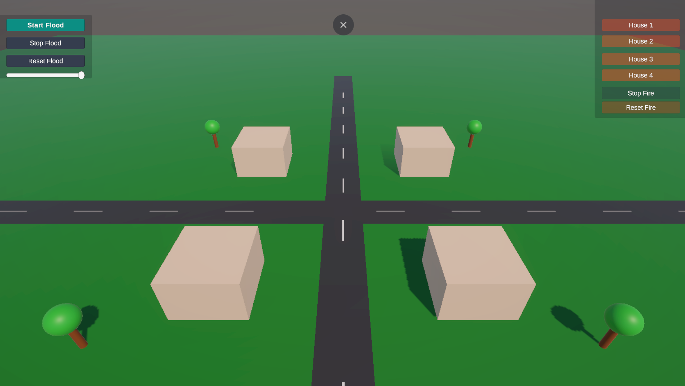
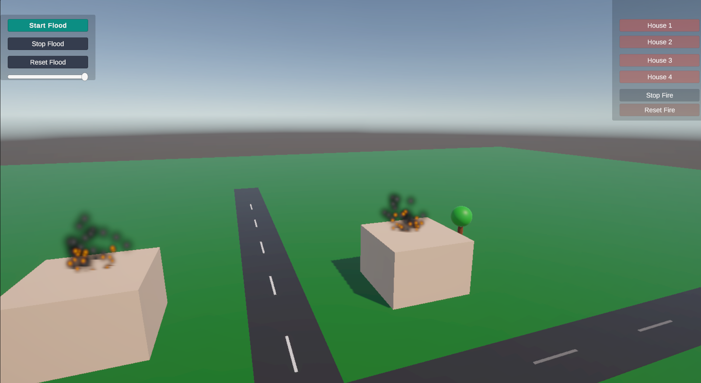
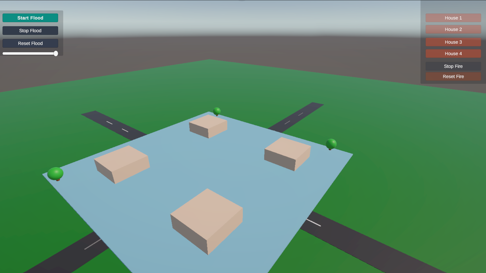

# Smart Town Digital Twin

Smart Town Digital Twin is a small 3D town simulation built with Unity. It demonstrates an interactive virtual environment with basic camera navigation, a flood simulation, and a fire simulation.

The project was developed as a technical assessment to demonstrate 3D environment creation, C# scripting, interactive controls, and browser deployment.

## Live Demo

**[Open Smart Town Digital Twin](https://smart-town-digital-twin.netlify.app/)**

The application runs in a web browser and allows users to explore the town and test the simulations.

## Screenshots

### Town Environment

The environment contains roads, buildings, trees, and an interactive camera.

### Fire Simulation

The fire simulation lets users select a building, display fire and smoke effects, and observe fire spreading to other buildings.

### Flood Simulation

The flood simulation includes start, stop, reset, and water-level controls.

## Video Demonstration

Click the preview below to watch the complete demonstration.

The video demonstrates the town environment, camera navigation, flood controls, and fire simulation.

## Features

I tried keeping the project simple and explainable in itself and easy to navigate

- Interactive 3D town environment.
- Camera movement using keyboard controls.
- Camera rotation using the right mouse button.
- Zoom using the mouse scroll wheel.
- Flood simulation with start, stop, reset, and water-level controls.
- Fire simulation with selectable building locations.
- Fire and smoke particle effects.
- Fire spreading over time.
- Separate control panels for flood and fire simulations.
- Browser-based deployment through Netlify.

## Controls

| Action        | Control                          |
| ------------- | -------------------------------- |
| Move camera   | W, A, S, D                       |
| Rotate camera | Hold right mouse button and drag |
| Zoom          | Mouse scroll wheel               |
| Start flood   | Flood panel or F                 |
| Stop flood    | Flood panel or T                 |
| Reset flood   | Flood panel or R                 |
| Start fire    | Fire panel or G                  |
| Stop fire     | Fire panel or H                  |
| Reset fire    | Fire panel or J                  |

The on-screen buttons can also be used to control the simulations.

## Technologies Used

- Unity 6
- C#
- Unity UI
- Unity Particle System
- Netlify

## Challenges Faced

During development, I faced a few challenges while setting up the Unity environment, implementing the simulations, and deploying the project to a web browser.

- **Setup:** Since I was very new with Unity setup required attention on every detail and a single mistake was leading to fresh beggining

- **Object Alignment:** Proper aligning the elements according the coordinates and at the proper place

- **Flood simulation:** Implementing gradually rising water with start, stop, reset, and water-level controls required connecting the simulation logic with the UI.

- **Fire simulation and spreading:** Managing fire and smoke particle effects, selecting different buildings as fire locations, and implementing fire spread over time required coordinating the simulation scripts and scene objects.

- **UI integration:** Connecting the flood and fire control panels to the correct simulation methods required careful configuration of button events and references in the Unity Inspector.

- **Web deployment:** The Web build worked locally but initially failed on Netlify because the hosting server did not provide the correct HTTP headers for Brotli-compressed files. I resolved this by configuring the appropriate response headers using a `netlify.toml` file.

These challenges helped me understand Unity's scene management, C# scripting, UI event handling, particle systems, and the differences between running a project locally and deploying it to a web server.

## Running Locally

1. Clone this repository.
2. Open Unity Hub.
3. Select **Add project from disk** and choose the cloned project folder.
4. Open the project using a compatible Unity 6 editor version.
5. Open the main scene and press Play.

Allow Unity to import the required assets and packages before running the project.

## Deployment

The project was built for the Web platform in Unity and deployed using Netlify.

The live version is available at:

https://smart-town-digital-twin.netlify.app/

## Project Structure

- `Assets/` — scenes, scripts, materials, and other Unity assets.
- `Packages/` — Unity package configuration.
- `ProjectSettings/` — project settings.
- `docs/screenshots/` — screenshots used in this README.

## Author

Sristy
